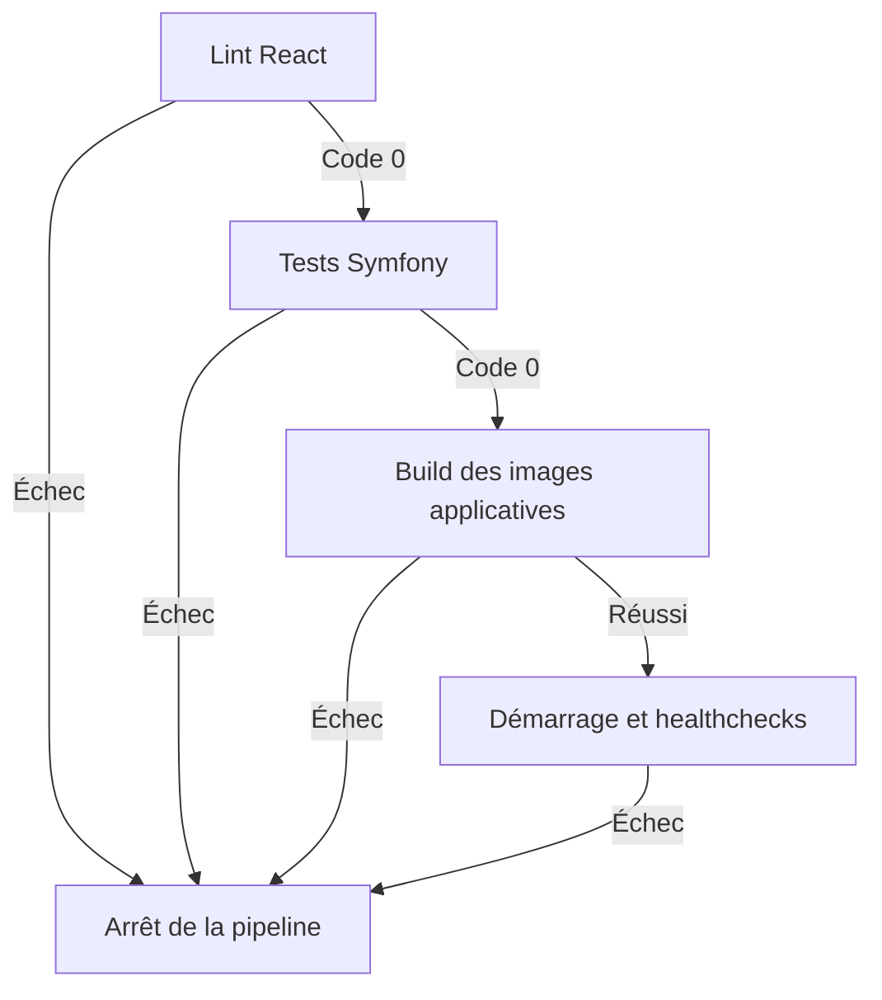
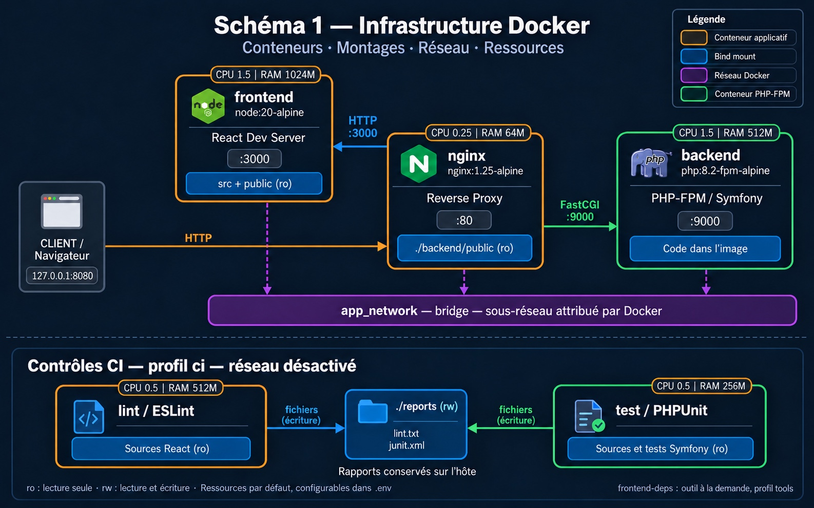
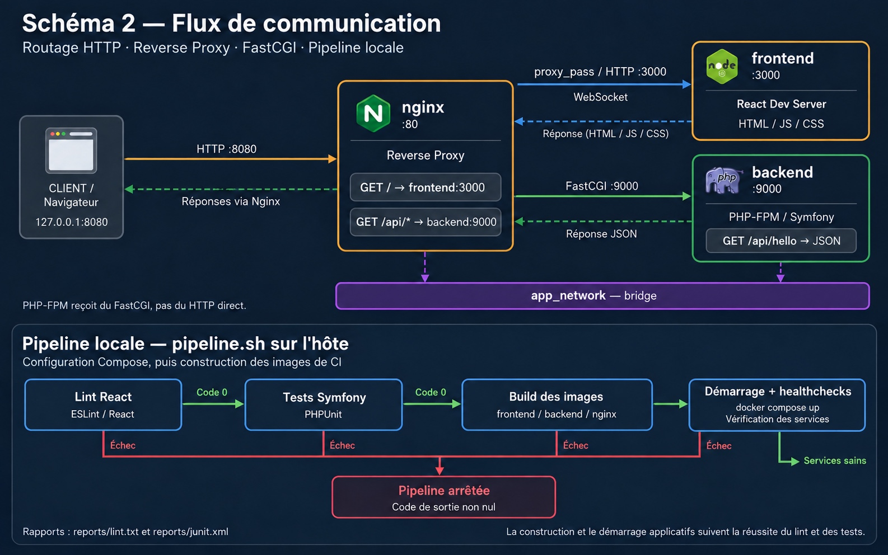

# TP Docker – Gestion d'une entreprise de soutien scolaire

**Auteur : Julio Tepixtle**

Le projet met en place une architecture Docker pour une plateforme de gestion d'une
entreprise de soutien scolaire. Le domaine métier comprend le planning des cours,
les paiements et abonnements, ainsi que les espaces parent, professeur et administrateur.

Le socle applicatif comprend une interface React, une API Symfony et un serveur web Nginx.
La version actuelle expose une page « Hello World » et une route JSON pour vérifier les
communications entre les services. Les modules métier ne sont pas implémentés à ce stade.
Un conteneur de lint contrôle automatiquement la qualité du code frontend.
Un conteneur de tests vérifie les réponses de l'API Symfony.
Le script `pipeline.sh` enchaîne les contrôles et le déploiement local.

## Démarrage

Prérequis : Docker Desktop démarré et Docker Compose. Les commandes Node.js et npm
s'exécutent dans les conteneurs.

Pour une nouvelle copie du dépôt, préparer la configuration locale :

```sh
cp .env.example .env
```

Choisir ensuite une valeur locale pour `APP_SECRET` dans `.env`. Une clé peut être générée
avec `openssl rand -hex 32`. Conserver un `.env` existant plutôt que l'écraser.

Pour préparer ou actualiser `frontend/package-lock.json`, utiliser l'outil de dépendances
depuis la racine du dépôt :

```sh
docker compose run --rm --no-deps --build frontend-deps
```

Cette commande met à jour le verrouillage et vérifie sa cohérence avec `npm ci --dry-run`
dans le même environnement Node/npm que le frontend. Elle retourne un échec si une étape
échoue. Le fichier produit dans `frontend/` doit être versionné avec `package.json`.
Le build de l'application utilise ensuite `npm ci` pour installer les versions verrouillées.

Depuis la racine du projet :

```sh
./pipeline.sh
docker compose ps
curl --fail --show-error http://127.0.0.1:8080/
curl --fail --show-error http://127.0.0.1:8080/api/hello
```

Le frontend doit afficher « Hello World ». L'API doit répondre en JSON avec le message
`Hello World`. Si `HTTP_PORT` change, adapter les URLs.

```sh
docker compose logs --tail=100 backend frontend nginx
docker compose down
```

`docker compose down` arrête les conteneurs et supprime le réseau de cette stack.

## Pipeline CI/CD locale

La commande `./pipeline.sh` réalise les opérations dans cet ordre :

1. Vérifier la configuration Compose.
2. Construire les images de lint et de tests.
3. Exécuter le lint React.
4. Exécuter les tests Symfony si le lint réussit.
5. Construire les trois images applicatives si les tests réussissent.
6. Démarrer les services et attendre leurs healthchecks.



La CI correspond aux contrôles de code et aux tests. La partie CD construit les images
applicatives puis lance l'application sur la machine Docker. Le script joue le rôle d'un
serveur de CI local : il vérifie le code de sortie de chaque commande avant de poursuivre.
Les dépendances `depends_on` de Compose gèrent ensuite l'ordre de démarrage des services.

Les contrôles utilisent `docker compose run --rm --no-deps -T`. Chaque exécution crée un
nouveau conteneur, n'en démarre pas d'autre et transmet son résultat au script. `-T` évite
l'utilisation d'un terminal interactif. Les rapports du lancement précédent sont retirés
avant les contrôles ; les nouveaux restent disponibles dans `reports/`.

`up --no-build --wait` utilise les images qui viennent d'être construites et attend que
les trois services soient sains. Le délai est de 180 secondes par défaut. Pour l'adapter :

```sh
PIPELINE_WAIT_TIMEOUT=300 ./pipeline.sh
```

Cette variable est fournie à la commande dans le terminal. Les quotas des conteneurs et
le port HTTP restent configurés dans `.env`.

Si un contrôle échoue, le script s'arrête avant la construction et le démarrage applicatifs.
Les conteneurs applicatifs en cours ne sont pas recréés à ce stade. Les montages de
développement restent actifs : les changements des sources React peuvent donc être visibles
immédiatement dans une application déjà lancée.

Si les healthchecks échouent après le démarrage, la pipeline retourne un échec. Les services
peuvent alors être inspectés avec `docker compose ps` et `docker compose logs` ; le script
n'effectue pas de retour automatique à une image précédente.

Le script gère `SIGINT` et `SIGTERM`. Il arrête le conteneur de contrôle actif, identifié
par un nom propre à cette exécution, puis termine la commande Docker en cours. Les codes
`130` et `143` indiquent respectivement ces interruptions.

### Vérifier le blocage de la pipeline

1. Lancer une première fois `./pipeline.sh` avec un code valide.
2. Ajouter temporairement une variable inutilisée dans `frontend/src/App.js` et relancer.
   La pipeline doit s'arrêter au lint ; le rapport JUnit précédent doit avoir été supprimé.
3. Retirer cette variable, modifier temporairement le message de `/api/hello`, puis relancer.
   Le lint doit passer et les tests doivent échouer avant la construction applicative.
4. Remettre `Hello World` dans le contrôleur et relancer pour retrouver une pipeline réussie.

Les commandes individuelles ci-dessous permettent également de relancer un seul contrôle.
Pour un démarrage de développement direct, utiliser
`docker compose up --build -d --wait --wait-timeout 180`.

## Contrôle statique du code

Le lint est une étape de CI : il analyse le code JavaScript et JSX sans exécuter les
fonctionnalités de l'application. Il détecte notamment les variables inutilisées, les noms
non définis, les comparaisons non strictes et les problèmes couverts par les règles React.

Depuis la racine du dépôt :

```sh
docker compose run --rm --no-deps --build lint
```

Le contrôle doit se terminer avec zéro erreur et zéro avertissement. Son résultat est affiché
dans le terminal et enregistré dans `reports/lint.txt`, un fichier généré ignoré par Git.

| Code de sortie | Signification |
|---|---|
| `0` | Analyse réussie, sans erreur ni avertissement. |
| `1` | Au moins une erreur ou un avertissement détecté dans le code. |
| `2` | Problème empêchant l'analyse ou l'écriture du rapport. |
| `143` | Analyse interrompue par `SIGTERM`. |

Ces codes permettent à une pipeline de décider si elle peut poursuivre son exécution.
Le conteneur fonctionne indépendamment du frontend, du backend et de Nginx.

Pour vérifier que le contrôle détecte un défaut, ajouter temporairement une variable
inutilisée dans `frontend/src/App.js`, par exemple `const variableInutilisee = 42;`.
Relancer le lint : il doit signaler `no-unused-vars` et sortir avec le code `1`.
Retirer ensuite cette variable et relancer le contrôle pour obtenir le code `0`.

## Tests de l'API Symfony

Les tests utilisent PHPUnit et passent par le routeur et les contrôleurs Symfony.
Le noyau traite les requêtes en mémoire : Nginx, React et un serveur PHP-FPM ne sont pas
nécessaires pour lancer ce contrôle.

```sh
docker compose run --rm --no-deps --build test
```

| Test | Résultat attendu |
|---|---|
| `GET /api/hello` | Réponse `200`, format JSON, message et nom du service attendus. |
| `GET /` dans Symfony | Réponse `200` et statut `OK`. |
| `POST /api/hello` | Réponse `405`, car cette route accepte seulement les requêtes GET. |
| `GET /api/inconnue` | Réponse `404`. |

La racine est testée directement dans Symfony. Dans l'application accessible au navigateur,
Nginx envoie cette même URL à React.

Les quatre tests doivent réussir. PHPUnit retourne `0` en cas de réussite et une valeur
différente en cas d'échec ou d'erreur. Le rapport est conservé dans `reports/junit.xml`.
Le format JUnit permet à un outil de CI de lire les résultats de chaque test.

Pour vérifier qu'une régression est détectée, remplacer temporairement `Hello World`
par un autre message dans `backend/src/Controller/HelloController.php`, puis relancer :

```sh
docker compose run --rm --no-deps test
```

Le test de `/api/hello` doit échouer. Remettre ensuite le message initial et relancer les tests.
Les sources sont montées dans le conteneur : une modification du contrôleur ne demande pas
de reconstruire l'image de tests.

## Architecture et communications

### Infrastructure Docker



### Communications et enchaînement des contrôles



Seul Nginx publie un port, limité à `127.0.0.1` pour l'usage local. React et PHP-FPM
communiquent sur le réseau bridge `app_network`, par leurs noms de service.
Docker choisit le sous-réseau : aucune plage IP fixe n'est imposée.
Il n'y a pas encore de service de base de données ni de connexion SQL utilisée par l'API.
Les conteneurs de lint et de tests ont leur réseau désactivé. Ils lisent les fichiers montés
et écrivent leurs rapports dans le même dossier de l'hôte. Le script enchaîne leurs exécutions.

## Images personnalisées

Chaque service a son Dockerfile et sa personnalisation à partir d'une image de base.
Les dépendances applicatives sont installées depuis les manifestes de ce dépôt.

| Service | Contexte de build | Image produite | Personnalisation |
|---|---|---|---|
| Frontend | `frontend/` | `tp-docker/frontend:1.0-dev` | Code React, dépendances npm et commande du serveur de développement. |
| Backend | `backend/` | `tp-docker/backend:1.0-dev` | Extensions PHP, dépendances Symfony, utilisateur et entrypoint de configuration. |
| Serveur web | `ngnix/` | `tp-docker/nginx:1.0` | Routage HTTP/FastCGI, modèle de configuration et healthcheck. |
| Lint | Racine du dépôt, `ci/Dockerfile.lint` | `tp-docker/lint:1.0` | Configuration ESLint, analyse des sources et production d'un rapport. |
| Tests | Racine du dépôt, `ci/Dockerfile.test` | `tp-docker/test:1.0` | PHPUnit, tests de l'API et rapport JUnit. |
| Outil de dépendances | `frontend/`, cible `tooling` | `tp-docker/frontend-tooling:1.0-dev` | Manifeste npm et environnement commun à l'image frontend pour préparer son verrouillage. |

### Frontend React

- Image de base : `node:20-alpine`. Node.js exécute les outils React ; la variante Alpine
  fournit un environnement système minimal.
- La cible `tooling` prépare le répertoire de travail et copie `package.json`. La cible
  `development` en hérite et installe les dépendances applicatives depuis le lock.
- `WORKDIR /app` définit le répertoire de travail ; `COPY` apporte les manifestes puis le code.
- `npm ci` installe les versions de `package-lock.json` et échoue si ce fichier diverge de `package.json`.
- `react` et `react-dom` rendent l'interface ; `react-scripts` fournit le serveur de développement
  et le build ; `ajv` fournit un validateur de schémas JSON aux outils JavaScript.
- `typescript` est fixé à `4.9.5` comme dépendance de développement pour respecter la
  compatibilité de l'outillage `react-scripts` ; les sources de l'interface restent en JavaScript.
- Aucun paquet système supplémentaire n'est installé.
- Port interne : `3000`. Cette image exécute un serveur React de développement, avec rechargement
  des sources pour afficher les modifications de l'interface.
- L'entrypoint Node officiel est conservé. La commande finale lance directement
  `node node_modules/react-scripts/scripts/start.js`, sans processus npm intermédiaire.
- `init: true` ajoute un petit processus d'initialisation qui transmet les signaux et récupère
  les processus enfants terminés.

Les montages `frontend/src` et `frontend/public` sont en lecture seule. Les dépendances
sont installées dans l'image, tandis que les sources et fichiers publics proviennent des montages.
Après une modification de `package.json`, exécuter `frontend-deps` puis reconstruire l'image.

### Image de lint et choix de CI

- `ci/Dockerfile.lint` construit une image personnalisée à partir de `node:20-alpine`,
  comme le frontend, afin d'utiliser le même environnement Node/npm.
- ESLint est adapté au JavaScript et au JSX du projet. Sa version `8.57.1` et celle de
  `eslint-config-react-app` (`7.0.1`) sont déjà verrouillées dans `frontend/package-lock.json`
  par les dépendances de `react-scripts`.
- Le même manifeste et le même lock sont utilisés par le frontend et le lint pour garder
  un seul ensemble de versions. Ce choix installe aussi les dépendances du frontend dans
  l'image de lint ; il évite de maintenir un second verrouillage de l'outillage React.
- `npm ci --ignore-scripts` installe les dépendances verrouillées sans exécuter leurs scripts
  d'installation. Aucun paquet système supplémentaire n'est nécessaire.
- `WORKDIR /app` fixe le répertoire d'analyse. `COPY` apporte les manifestes, la configuration,
  les sources et le programme de lancement `ci/lint.cjs`.
- Le `.dockerignore` à la racine exclut notamment les fichiers d'environnement locaux,
  les dépendances de l'hôte et les rapports du contexte de build.
- `NODE_ENV=development` fournit le contexte attendu par l'outillage Babel/React.
  `FORCE_COLOR=0` garde un rapport texte sans codes de couleur.

La configuration `frontend/.eslintrc.json` étend les règles de `react-app`. Les règles
`no-unused-vars`, `no-undef` et `eqeqeq` sont traitées comme des erreurs pour détecter
respectivement les variables inutilisées, les identifiants inconnus et les comparaisons
non strictes. `root: true` limite la recherche de configuration à ce projet.

L'entrypoint lance directement `node /app/ci/lint.cjs`. Le programme utilise l'API ESLint,
désactive les corrections automatiques et le cache, puis écrit le rapport avec les fonctions
standard de Node.js (`mkdir` et `writeFile`). Il conserve un code de sortie exploitable par
la CI, y compris en cas d'erreur de configuration. Son gestionnaire `SIGTERM` arrête l'analyse
avec le code `143` ; `init: true` transmet le signal au processus Node.

Le service appartient au profil `ci` : le démarrage habituel de l'application lance uniquement
les trois services applicatifs. Un `docker compose run lint` active ce service explicitement.
`restart: "no"` convient à un contrôle qui se termine, et `--rm` supprime son conteneur après
l'exécution. Aucun healthcheck n'est requis pour cette tâche ponctuelle.

Les sources et la configuration ESLint sont montées en lecture seule. Seul `reports/` est
monté en écriture pour conserver le résultat sur l'hôte. Le conteneur n'expose aucun port et
utilise `network_mode: none` : l'analyse n'a pas besoin de communiquer avec l'application ni
avec Internet. Les téléchargements npm ont lieu au build, avant cette isolation réseau.

### Image de tests et choix de CI

- La base `php:8.2-cli-alpine` utilise la même version majeure et mineure de PHP que le backend.
  Le mode CLI convient à une commande de tests qui se termine après son exécution.
- PHPUnit `11.5.57` est compatible avec PHP 8.2. Il est téléchargé sous forme de PHAR,
  une archive contenant l'outil et ses dépendances. La version est fixée au build.
- Ce choix garde PHPUnit dans l'image de tests et conserve le `composer.lock` de l'application.
- `curl` télécharge les installateurs et le PHAR ; `unzip` extrait les dépendances Composer ;
  `git` permet à Composer de récupérer un paquet depuis un dépôt si nécessaire.
- `composer install --no-dev --no-scripts` installe les dépendances de l'application depuis
  le lock. Les scripts de démarrage de Symfony ne sont pas lancés pendant cette installation.
- `WORKDIR /app` fixe le répertoire de travail. `COPY` apporte les sources, la configuration,
  les tests et les valeurs publiques de `backend/.env.example`.

`APP_ENV=test`, `APP_DEBUG=0`, `APP_SECRET=ci-test-secret` et `DEFAULT_URI` sont définis dans
l'image pour isoler l'exécution des tests. La clé utilisée ici est une valeur publique de test.
Le fichier `tests/bootstrap.php` charge l'autoloader Composer et les valeurs d'environnement.

`backend/phpunit.xml` indique le dossier des tests et place le cache PHPUnit dans `/tmp`.
Chaque test crée un noyau Symfony, envoie une requête, vérifie la réponse et ferme le noyau.
Le cache Symfony reste dans le conteneur, qui est supprimé après le contrôle.

L'entrypoint lance `ci/test-entrypoint.sh`. Le script crée le dossier des rapports avec
`mkdir`, retire l'ancien rapport avec `rm` et lance PHPUnit avec `exec`. Le code de sortie
de PHPUnit est ainsi transmis à Docker, et le signal `SIGTERM` arrive au processus PHP.
La mémoire PHP est limitée à `128M` ; le quota Docker limite l'ensemble du conteneur.

Le service `test` appartient au profil `ci`, utilise `restart: "no"` et ne publie aucun port.
`network_mode: none` convient aux requêtes traitées en mémoire. Les téléchargements ont lieu
au build. Le code, les tests et la configuration sont montés en lecture seule ; seul le
dossier `reports/` est monté en écriture. Aucun outil PHP n'est à installer sur la machine hôte.

### Outil de gestion des dépendances

`frontend-deps` est un conteneur ponctuel du profil `tools`. Il est lancé explicitement
avec `docker compose run` et reste exclu du démarrage habituel de l'application.
Il utilise la cible `tooling` du Dockerfile frontend : aucun verrouillage préalable n'est
nécessaire pour construire cet outil.

Le dossier `frontend/` est monté en lecture-écriture pour enregistrer `package-lock.json`
dans le dépôt. `npm install --package-lock-only` actualise ce fichier sans installer les
dépendances sur la machine hôte. `--ignore-scripts` désactive les scripts des paquets pendant
cette opération. La vérification `npm ci --dry-run` contrôle ensuite la cohérence du résultat
sans installation. L'installation complète s'effectue au build de la cible `development`.

La commande utilise `sh -ec` pour interrompre le traitement dès qu'une étape échoue.
`restart: "no"` correspond à une tâche qui se termine, et `--rm` supprime le conteneur après
son exécution. L'outil n'expose aucun port et utilise les mêmes quotas CPU/RAM que le frontend.

### Backend Symfony

- Image de base : `php:8.2-fpm-alpine`, compatible avec la contrainte PHP du projet Symfony.
  PHP-FPM gère les processus PHP et reçoit les requêtes FastCGI de Nginx.
- Le serveur utilise le protocole FastCGI sur le port interne `9000`.

| Dépendance système | Utilité |
|---|---|
| `git` | Permet à Composer de récupérer une dépendance depuis un dépôt si nécessaire. |
| `unzip` | Extraction des archives de dépendances Composer. |
| `curl` | Téléchargement de l'installateur Composer ; `-f` fait échouer le build sur une erreur HTTP. |
| `icu-libs`, `libzip` | Bibliothèques conservées à l'exécution pour les extensions `intl` et `zip`. |
| `icu-dev`, `libzip-dev`, `$PHPIZE_DEPS` | En-têtes et outils de compilation regroupés dans `.build-deps`, puis retirés. |

`apk add --no-cache` évite de conserver un cache d'index de paquets. `apk del .build-deps`
retire les outils de compilation, tout en conservant les bibliothèques d'exécution.

| Extension PHP compilée | Utilité |
|---|---|
| `intl` | Outils d'internationalisation, dates et formats. |
| `zip` | Gestion des archives ZIP. |
| `opcache` | Cache du bytecode PHP ; la vérification des fichiers reste active en développement. |
| `pdo_mysql` | Pilote PDO pour une connexion MySQL ; aucune connexion SQL n'est utilisée par l'API actuelle. |

Composer est installé dans `/usr/local/bin`, puis son installateur temporaire est supprimé.
`composer install` utilise `composer.lock`, avec `--no-dev` pour l'image applicative et
`--no-scripts` tant que le code n'est pas copié. Après la copie, l'autoloader est régénéré
et les scripts Symfony sont exécutés. L'échec d'un script interrompt la construction de l'image.
Les dépendances PHP sont définies par `composer.json` et verrouillées dans `composer.lock`.

L'utilisateur `symfony` (UID/GID 1000) est créé avec `addgroup` et `adduser`.
`COPY --chown` lui attribue le code, et `mkdir`/`chown` préparent `var/cache` et `var/log`.
Le backend s'exécute sous cet utilisateur.

`backend/.env.example` contient uniquement des valeurs publiques de développement et est
copié vers `.env` dans l'image. Les fichiers `.env` locaux sont exclus du contexte de build.
Les variables injectées par Compose prennent le dessus sur ces valeurs au démarrage.
`DEFAULT_URI` définit l'URL de référence utilisée par le routeur Symfony dans les commandes
CLI, notamment pendant la préparation du cache. Sa valeur au build est `http://127.0.0.1:8080` ;
au démarrage, Compose permet de la personnaliser et utilise le port `HTTP_PORT` par défaut.

L'entrypoint personnalisé vérifie les valeurs reçues, puis écrit :

- `PHP_MEMORY_LIMIT` dans `/usr/local/etc/php/conf.d/zz-runtime.ini` ;
- `PHP_FPM_MAX_CHILDREN` dans `/usr/local/etc/php-fpm.d/zz-runtime.conf`.

Ces fichiers sont créés avec `touch` et attribués à `symfony` au build ; `chmod +x`
rend le script exécutable dans l'image. Le pool fonctionne en mode `ondemand` : les workers
sont créés à la demande et libérés après 10 secondes d'inactivité.
Le script finit par `exec docker-php-entrypoint "$@"`, qui transmet la main à `php-fpm -F`.
L'option `-F` maintient PHP-FPM au premier plan.

Le code du backend est copié dans l'image lors du build. Une reconstruction suivie d'un
`docker compose up` permet de déployer ses changements.
Nginx monte seulement `backend/public` en lecture seule pour localiser le point d'entrée PHP.

### Serveur web Nginx

- Image de base : `nginx:1.25-alpine`. Nginx fournit un point d'entrée HTTP unique et prend
  en charge le proxy HTTP, les WebSocket et le protocole FastCGI.
- `curl` est ajouté pour le healthcheck.
- La configuration par défaut est retirée avec `rm` et remplacée par nos fichiers.
- `webuser` (UID/GID 1001) est créé pour les workers. Le processus maître reste root pour
  ouvrir le port 80, puis les workers utilisent `user webuser`.
- `nginx.conf` est copié comme modèle dans `/etc/nginx/templates/nginx.conf.template`.
- L'entrypoint officiel rend ce modèle dans `/etc/nginx/nginx.conf` grâce à `envsubst`.
  Le filtre `^NGINX_WORKER_` limite les substitutions aux paramètres des workers et conserve
  les variables Nginx telles que `$host` ou `$request`.
- `default.conf` envoie `/api/*` à Symfony via FastCGI, et les autres requêtes à React,
  y compris les connexions WebSocket du rechargement automatique.
- Les logs vont vers stdout/stderr, visibles avec `docker compose logs`.
- `nginx -g 'daemon off;'` maintient le serveur au premier plan.

## Arguments au run et ressources

Le `.env` à la racine sert à l'interpolation Compose. Seules les variables déclarées dans
`environment` sont transmises aux services concernés.
Les fichiers `.env.example` sont versionnés ; les fichiers de configuration locaux sont ignorés.

| Service | Paramètres des quotas | Valeurs par défaut | Justification |
|---|---|---|---|
| Frontend et outil de dépendances | `FRONTEND_CPUS`, `FRONTEND_MEMORY` | 1,5 CPU / 1024 Mo | Budget pour la compilation React ou la résolution ponctuelle des dépendances npm. |
| Backend | `BACKEND_CPUS`, `BACKEND_MEMORY` | 1,5 CPU / 512 Mo | Budget partagé par PHP-FPM, ses workers et OPcache. |
| Nginx | `NGINX_CPUS`, `NGINX_MEMORY` | 0,25 CPU / 64 Mo | Proxy léger, avec un worker par défaut. |
| Lint | `LINT_CPUS`, `LINT_MEMORY` | 0,5 CPU / 512 Mo | Analyse ponctuelle d'un petit frontend, avec chargement du parseur et des règles React. |
| Tests | `TEST_CPUS`, `TEST_MEMORY` | 0,5 CPU / 256 Mo | Exécution de PHPUnit et du noyau Symfony pour les quatre tests de l'API. |

`cpus` limite le temps CPU et `mem_limit` la mémoire du conteneur. Ce sont des plafonds,
pas des réservations. Ils s'appliquent aux conteneurs lancés, pas aux commandes de build.
Avec `docker run`, les options correspondantes sont `--cpus` et `--memory` ; `--env`
transmet les variables d'environnement et `--publish` configure la publication des ports.

| Paramètre | Effet |
|---|---|
| `HTTP_PORT=8080` | Publication locale du port 80 de Nginx. |
| `APP_ENV=dev`, `APP_DEBUG=1` | Environnement Symfony et activation du debug local. |
| `APP_SECRET` | Clé Symfony, exigée et non vide dans Compose. |
| `DEFAULT_URI` | URL de référence pour les commandes Symfony, par défaut `http://127.0.0.1:8080`. |
| `PHP_FPM_MAX_CHILDREN=2` | Maximum de workers PHP-FPM simultanés. |
| `PHP_MEMORY_LIMIT=128M` | Limite mémoire PHP par traitement, distincte du quota total du conteneur. |
| `NGINX_WORKER_PROCESSES=1` | Nombre de workers Nginx (`auto` est également accepté par Nginx). |
| `NGINX_WORKER_CONNECTIONS=1024` | Maximum de connexions par worker Nginx. |
| `HOST`, `PORT`, `WATCHPACK_POLLING`, `WDS_SOCKET_PORT` | Écoute React sur le réseau Docker et rechargement via le proxy. |
| `LINT_REPORT_DIR=/reports` | Répertoire du rapport dans le conteneur de lint, monté vers `reports/` sur l'hôte. |
| `TEST_REPORT_DIR=/reports` | Répertoire du rapport JUnit dans le conteneur de tests. |

Les quotas sont adaptés à une exécution locale, à observer avec `docker stats`.
La mémoire des workers et le cache partagé consomment le budget total du backend : augmenter
le nombre de workers peut nécessiter d'adapter ce budget.

## Disponibilité et ordre de démarrage

1. Le backend démarre ; son healthcheck vérifie qu'un processus accepte les connexions sur `9000`.
2. Le frontend attend le backend sain ; son healthcheck attend une réponse HTTP sur `3000`.
3. Nginx attend les deux services sains ; son propre healthcheck vérifie `/api/hello` et `/`.

`depends_on: condition: service_healthy` attend la disponibilité, au-delà du simple lancement
initial d'un conteneur. `php-fpm -t` permet de valider la syntaxe de la configuration ;
le contrôle TCP du backend vérifie qu'un processus accepte les connexions.
Les contrôles HTTP de Nginx vérifient ensuite la disponibilité du frontend et de l'API.
La pipeline lance ces services après le succès du lint et des tests, puis attend les
healthchecks avant d'annoncer une réussite.

## Signaux d'arrêt

Les services déclarent `SIGTERM`. Node reçoit le signal via l'init de Compose ; PHP-FPM
et Nginx le reçoivent grâce aux commandes lancées avec `exec` par leurs entrypoints.

Pour Nginx et PHP-FPM, `SIGTERM` demande un arrêt rapide ; `SIGQUIT` est leur signal d'arrêt
gracieux. `stop_grace_period` donne à Docker un délai avant un éventuel `SIGKILL` et ne transforme
pas `SIGTERM` en arrêt gracieux. Les délais sont de 10 secondes pour React/Nginx et de 30 pour PHP.

Pour contrôler l'arrêt sur la machine Docker :

```sh
docker compose stop
docker compose ps -a
docker compose logs --tail=50 backend frontend nginx
```

Relancer les services avec `docker compose up -d --wait`.

## Vérifier les paramètres appliqués

```sh
docker compose exec backend php -r 'echo ini_get("memory_limit"), PHP_EOL;'
docker compose exec backend php-fpm -tt
docker compose exec nginx nginx -T
docker stats --no-stream
```

Attendre notamment `128M` pour PHP et les valeurs de workers choisies dans la configuration
Nginx générée. Après un changement du `.env`, relancer `docker compose up -d --wait` pour recréer
les services dont la configuration change. Après un changement des Dockerfiles, dépendances
ou sources du backend, utiliser `docker compose up --build -d --wait --wait-timeout 180`.

## Références

- [Installation npm reproductible](https://docs.npmjs.com/cli/commands/npm-ci/)
- [API Node.js ESLint](https://archive.eslint.org/docs/developer-guide/nodejs-api)
- [Services optionnels avec les profils Compose](https://docs.docker.com/compose/how-tos/profiles/)
- [Conteneurs ponctuels avec Compose](https://docs.docker.com/reference/cli/docker/compose/run/)
- [Démarrage et attente des services](https://docs.docker.com/reference/cli/docker/compose/up/)
- [Installation Composer depuis le lock](https://getcomposer.org/doc/03-cli.md#install-i)
- [Configuration Symfony](https://symfony.com/doc/7.2/configuration.html)
- [Tests Symfony](https://symfony.com/doc/7.2/testing.html)
- [Compatibilité PHP et PHPUnit](https://phpunit.de/supported-versions.html)
- [Rendu des modèles Nginx](https://github.com/nginx/docker-nginx/blob/master/entrypoint/20-envsubst-on-templates.sh)
- [Signaux Nginx](https://nginx.org/en/docs/control.html)
- [Signaux PHP-FPM](https://github.com/php/php-src/blob/master/sapi/fpm/php-fpm.8.in)
